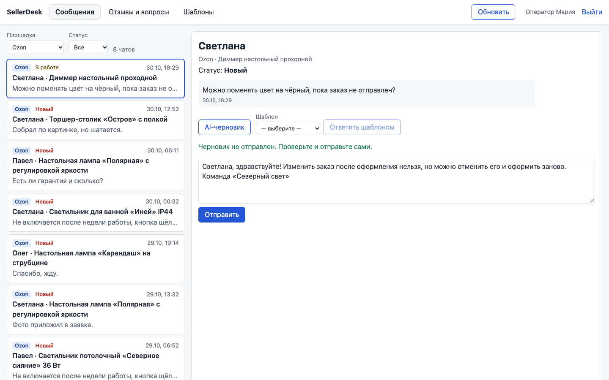
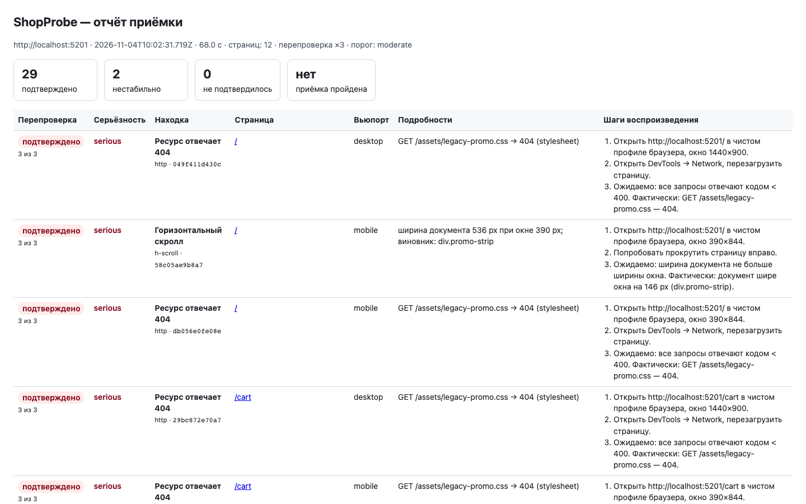
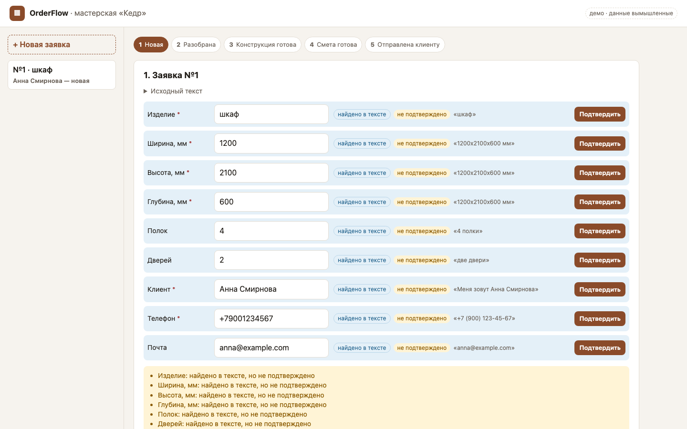
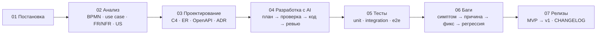

# AI Product Engineering

[](https://github.com/Georgy213123/ai-product-engineering/actions/workflows/ci.yml)
[](https://github.com/Georgy213123/ai-product-engineering/actions/workflows/codeql.yml)
[](LICENSE)

Три продуктовых кейса. Каждый пройден целиком: постановка задачи, системный анализ,
проектирование, разработка с AI-агентами, тестирование, разбор багов и релиз.
У каждого рабочий код, свои тесты и e2e на Playwright.

Георгий Андреев, Product Engineer. Код здесь писал Claude Code по моим брифам, ревьюил Codex.
Моя часть работы: постановка, решения (ADR), приёмка результата и разбор каждой находки ревью.
Как это устроено, описано в [`ai-workflow/`](ai-workflow/).

> **О происхождении кейсов.** Мои коммерческие проекты лежат у заказчиков в закрытых
> репозиториях. Кейсы ниже написаны заново: компании, данные и цифры в них вымышлены,
> внешние сервисы заменены заглушками. Задачи по типу те же, что я решаю в работе,
> и подход к ним тот же. Боевые системы могу показать на созвоне со своего экрана.

## Кейсы

| | Кейс | Задача | Что показывает | Стек |
|---|---|---|---|---|
| 01 | [**SellerDesk**](projects/01-sellerdesk/) | рабочее место оператора продавца на трёх маркетплейсах: чаты, отзывы, AI-черновики, шаблоны | интеграция с внешними API через адаптеры, фоновая синхронизация, идемпотентность, LLM без риска отправить лишнее | FastAPI · PostgreSQL · React · Playwright |
| 02 | [**ShopProbe**](projects/02-shopprobe/) | автоматическая приёмка интернет-витрины перед релизом | e2e и a11y на Playwright, перепроверка находок против ложных срабатываний, отчёт для владельца | Playwright · axe-core · FastAPI · React |
| 03 | [**OrderFlow**](projects/03-orderflow/) | мастерская мебели на заказ: заявка → конструкция → смета | системный анализ (BPMN, use case, FR/NFR, user stories), расчёт в копейках, машина состояний | FastAPI · PostgreSQL · React · Playwright |

<p>
  <a href="projects/01-sellerdesk/"></a>
  <a href="projects/02-shopprobe/"></a>
  <a href="projects/03-orderflow/"></a>
</p>

Все кейсы пройдены по одной дороге:



Документация во всех кейсах лежит по одному канону: [docs/CASE_STRUCTURE.md](docs/CASE_STRUCTURE.md).

## Как появился этот репозиторий

Витрину я собрал за два дня, 3 и 4 ноября 2026 года, к собеседованию. История коммитов
настоящая и поэтому короткая: месяцы разработки в ней не изображаются. Версии в CHANGELOG
кейсов — это этапы этих двух дней: MVP, исправления по ревью, второй круг ревью. Темп сборки
сам по себе часть демонстрации: так выглядит MVP с агентами, когда результат проверяется,
а не принимается на веру.

## Где AI ошибался и как это поймали

- **Агенты-исполнители выдумали ревью.** В первой версии `04-ai-development.md` стояли
  «замечания ревьюера Codex», хотя Codex ещё не запускался. Я заметил это при приёмке отчёта
  и заменил настоящим прогоном Codex.
- **Зелёные тесты, но ошибки в коде.** Codex нашёл 13, 11 и 10 проблем в коде, где все тесты
  проходили: дубль внешнего id после перезапуска, гонка двух запросов к одной заявке, поздний
  AI-черновик в чужом чате. Каждую находку сначала воспроизвёл падающий тест.
- **Исправление тоже надо ревьюить.** Фикс гонки в очереди синхронизации прошёл второй круг
  ревью и дал ещё 4 находки. Одна из них — регрессионный тест, который проходил и без фикса
  ([разбор](ai-workflow/examples/task-walkthrough.md)).
- **Продукт пропускал то, ради чего существует.** ShopProbe под дев-сервером Vite молча
  отбрасывал ошибки консоли приложения. Поймал, когда сверил скриншот отчёта с мета-тестом
  (BUG-09 в [06-bugs](projects/02-shopprobe/docs/06-bugs.md)).
- **Тесты не видят того, что видно глазами.** Свежий просмотр скриншотов (отдельный агент
  в роли техлида, без нашего контекста) нашёл два бага интерфейса, мимо которых прошли все
  тесты: разные статусы чата в ленте и в карточке, сырые дроби в смете. Оба исправлены
  с регрессионными тестами (BUG-11 в [SellerDesk](projects/01-sellerdesk/docs/06-bugs.md)
  и [OrderFlow](projects/03-orderflow/docs/06-bugs.md)).

## С чего начать

| Если есть 2 минуты | Если есть 15 минут |
|---|---|
| README любого кейса: задача, карта модулей, запуск | `docs/02-analysis/` кейса 03 — анализ без готового ТЗ |
| [ai-workflow/README.md](ai-workflow/README.md) — как идёт работа с агентами | `docs/04-ai-development.md` кейса 01 — настоящее ревью Codex и что по нему исправлено |
| | `docs/06-bugs.md` любого кейса — баги с регрессионными тестами |

## Запуск

```bash
cd projects/01-sellerdesk   # или 02-shopprobe, 03-orderflow
make install && make dev    # Python 3.12 + uv, Node.js 24, PostgreSQL 16
```

Через Docker: `make up` (`docker compose up`, PostgreSQL, API, фронт).
Проверки во всех кейсах одинаковые: `make lint`, `make test`, `make e2e`, `make audit`.

## Качество

| Что | Где |
|---|---|
| Линтеры и типы: ruff, mypy strict, ESLint, TypeScript strict, Prettier | `make lint`, CI |
| Unit и интеграционные тесты на настоящем PostgreSQL | `make test`, CI |
| E2E на Playwright, десктоп 1440×900 и телефон 390×844 | `make e2e`, CI |
| Контракт API: `openapi.yaml` сверяется с кодом тестом | `make test` |
| Аудит зависимостей (pip-audit, npm audit) | `make audit`, CI |
| Поиск секретов по всей истории (gitleaks), CodeQL, Dependabot | CI, pre-commit |
| Conventional Commits | pre-commit, CI на PR |

Последний полный прогон (чистая установка, PostgreSQL 16, переменные как в CI):

| Кейс | pytest (unit + integration) | покрытие бэкенда | Vitest | Playwright e2e |
|---|---|---|---|---|
| SellerDesk | 80 | 93 % | 15 | 12 |
| ShopProbe | 39 | — | 22 витрина + 37 ShopProbe | 33: 21 проверка ShopProbe на фикстурах, 11 витрины, 1 мета-тест с посаженными дефектами |
| OrderFlow | 82 | 97 % | 18 | 7 |

Каждый кейс прошёл независимое ревью Codex. Все находки разобраны в `docs/04-ai-development.md`
кейса: подтверждена ли находка тестом и что с ней сделано.

## Репозиторий

```
projects/        три кейса, у каждого свои README, Makefile, docker-compose, docs/01…07
ai-workflow/     CLAUDE.md, агенты, команды, skills, Playwright MCP, правила ревью
docs/            канон оформления кейса
.github/         CI, CodeQL, Dependabot, шаблоны issue и PR
```

[CONTRIBUTING.md](CONTRIBUTING.md) · [SECURITY.md](SECURITY.md) · [LICENSE](LICENSE)
