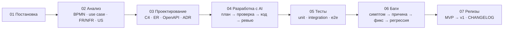

# AI Product Engineering

[](https://github.com/Georgy213123/ai-product-engineering/actions/workflows/ci.yml)
[](LICENSE)

Три продуктовых кейса и процесс, по которому они сделаны. Каждый кейс пройден целиком:
постановка задачи, системный анализ, проектирование, разработка с AI-агентами, тестирование,
разбор багов и релиз. У каждого свой репозиторий, рабочий код, тесты, e2e на Playwright и CI.

Георгий Андреев, Product Engineer. Код писал Claude Code по моим брифам, ревьюил Codex.
Моя часть работы: постановка, решения (ADR), приёмка результата и разбор каждой находки ревью.
Как это устроено, описано в [`ai-workflow/`](ai-workflow/).

> **О происхождении кейсов.** Мои коммерческие проекты лежат у заказчиков в закрытых
> репозиториях. Кейсы ниже написаны заново: компании, данные и цифры в них вымышлены,
> внешние сервисы заменены заглушками. Задачи по типу те же, что я решаю в работе,
> и подход к ним тот же. Рабочие проекты под NDA: о задачах и решениях расскажу на созвоне.

## Кейсы

| | Кейс | Задача | Что показывает | CI |
|---|---|---|---|---|
| 01 | [**SellerDesk**](https://github.com/Georgy213123/sellerdesk) | рабочее место оператора продавца на трёх маркетплейсах: чаты, отзывы, AI-черновики, шаблоны | интеграция с внешними API через адаптеры, фоновая синхронизация, идемпотентность, Claude API; автономный агент с чекпоинтом и бюджетом токенов | [](https://github.com/Georgy213123/sellerdesk/actions/workflows/ci.yml) |
| 02 | [**ShopProbe**](https://github.com/Georgy213123/shopprobe) | автоматическая приёмка интернет-витрины перед релизом | e2e и a11y на Playwright, перепроверка находок против ложных срабатываний, отчёт для владельца | [](https://github.com/Georgy213123/shopprobe/actions/workflows/ci.yml) |
| 03 | [**OrderFlow**](https://github.com/Georgy213123/orderflow) | мастерская мебели на заказ: заявка → конструкция → смета | системный анализ (BPMN, use case, FR/NFR, user stories), расчёт в копейках, машина состояний | [](https://github.com/Georgy213123/orderflow/actions/workflows/ci.yml) |

<p>
  <a href="https://github.com/Georgy213123/sellerdesk"></a>
  <a href="https://github.com/Georgy213123/shopprobe"></a>
  <a href="https://github.com/Georgy213123/orderflow"></a>
</p>

Стек у всех трёх общий: Python 3.12, FastAPI, SQLAlchemy 2, PostgreSQL 16, React + TypeScript (Vite),
Playwright, Docker Compose, GitHub Actions.

Порядок работы в каждом кейсе:



Документация в каждом кейсе лежит по одному канону: [docs/CASE_STRUCTURE.md](docs/CASE_STRUCTURE.md).

## Как появились кейсы

Витрину я собрал за два дня, 3 и 4 ноября 2026 года, к собеседованию. Сначала все три кейса
жили в одном репозитории, потом я разнёс их по отдельным. Коммиты здесь — крупные этапы сборки.
Исправления по первому ревью вошли внутрь этапов, поэтому порядок «падающий тест → фикс»
в истории виден не везде. У каждой находки в `docs/04-ai-development.md` указан тест, который
падает при откате исправления. Как это проверить командами, показано
в [разборе задачи](ai-workflow/examples/task-walkthrough.md#7-тот-же-путь-который-видно-в-истории). Версии в CHANGELOG — этапы
этих двух дней: MVP, исправления по ревью, второй круг ревью.

## Где AI ошибался и как это поймали

- **Агенты-исполнители выдумали ревью.** В первой версии `04-ai-development.md` стояли
  «замечания ревьюера Codex», хотя Codex ещё не запускался. Я заметил это при приёмке отчёта
  и запустил Codex по-настоящему.
- **Зелёные тесты, но ошибки в коде.** Codex нашёл 13, 11 и 10 проблем в коде, где все тесты
  проходили: дубль внешнего id после перезапуска, гонка двух запросов к одной заявке, поздний
  AI-черновик в чужом чате. Почти каждую находку подтвердил тест, красный до правки; две
  подтверждены чтением кода или запуском, это указано в разборе ShopProbe.
- **Исправление тоже надо ревьюить.** Фикс гонки в очереди синхронизации прошёл второй круг
  ревью и дал ещё 4 находки. Одна из них — регрессионный тест, который проходил и без фикса
  ([разбор](ai-workflow/examples/task-walkthrough.md)). Последнюю находку, отправку
  неподставленного шаблона, я провёл отдельными коммитами «красный тест → фикс», их можно
  проверить по истории SellerDesk (BUG-13).
- **Автономный агент ломается на долгом прогоне.** В агенте-маркетологе SellerDesk Codex нашёл
  9 проблем, которых не видно на коротком прогоне: ответ модели, потерянный при падении,
  не списывался из бюджета, временная ошибка убивала прогон, телефон с точками уходил
  в модель без маски. Исправлены до первого коммита модуля, у каждой тест
  ([ревью, круг 3](https://github.com/Georgy213123/sellerdesk/blob/main/docs/04-ai-development.md)).
- **Продукт пропускал то, ради чего существует.** ShopProbe под дев-сервером Vite молча
  отбрасывал ошибки консоли приложения. Поймал, когда сверил скриншот отчёта с мета-тестом
  (BUG-09 в [06-bugs](https://github.com/Georgy213123/shopprobe/blob/main/docs/06-bugs.md)).
- **Тесты не видят того, что видно глазами.** Свежий просмотр скриншотов (отдельный агент
  в роли техлида, без нашего контекста) нашёл два бага интерфейса, мимо которых прошли все
  тесты: разные статусы чата в ленте и в карточке, сырые дроби в смете. Оба исправлены
  с регрессионными тестами (BUG-11 в [SellerDesk](https://github.com/Georgy213123/sellerdesk/blob/main/docs/06-bugs.md)
  и [OrderFlow](https://github.com/Georgy213123/orderflow/blob/main/docs/06-bugs.md)).

- **Финальное ревью нашло то, что пропустили первые круги.** Перед публикацией витрину с нуля
  проверили отдельный агент-аудитор и Codex. Утечек не нашли, но нашли продуктовые баги
  при зелёном CI: тесты SellerDesk могли снести рабочую базу, неподставленный шаблон уходил
  обычной кнопкой, ShopProbe давал зелёную приёмку при сбое проверки, OrderFlow помечал смету
  отправленной до отправки. Все исправлены с тестами (SellerDesk BUG-12…15, ShopProbe BUG-10…11,
  OrderFlow BUG-12…13).

## С чего начать

За две минуты: README любого кейса и [ai-workflow](ai-workflow/README.md) — как идёт работа с агентами.

За пятнадцать: [анализ OrderFlow](https://github.com/Georgy213123/orderflow/tree/main/docs/02-analysis)
без готового ТЗ, [ревью Codex по SellerDesk](https://github.com/Georgy213123/sellerdesk/blob/main/docs/04-ai-development.md)
и что по нему исправлено, `docs/06-bugs.md` любого кейса.

## Запуск кейса

```bash
git clone https://github.com/Georgy213123/sellerdesk && cd sellerdesk   # или shopprobe, orderflow
make up                     # Docker: PostgreSQL, API, фронт
make install && make dev    # без Docker: Python 3.12 + uv, Node.js 24, PostgreSQL 16
```

Проверки во всех кейсах одинаковые: `make lint`, `make test`, `make e2e`, `make audit`.

## Качество

| Что | Где |
|---|---|
| Линтеры и типы: ruff, mypy strict, ESLint, TypeScript strict, Prettier | `make lint`, CI |
| Unit и интеграционные тесты на PostgreSQL 16, без SQLite-подмены | `make test`, CI |
| E2E на Playwright, десктоп 1440×900 и телефон 390×844 | `make e2e`, CI |
| Контракт API: `openapi.yaml` сверяется с кодом тестом | `make test` |
| Аудит зависимостей (pip-audit, npm audit) | `make audit`, CI |
| Стенд одной командой (`docker compose up --wait`) | CI |
| Поиск секретов по всей истории (gitleaks), CodeQL, Dependabot | CI, pre-commit |
| Conventional Commits | pre-commit, CI на PR |

Последний полный прогон (чистая установка, PostgreSQL 16, переменные как в CI):

| Кейс | pytest (unit + integration) | покрытие бэкенда | Vitest | Playwright e2e |
|---|---|---|---|---|
| SellerDesk | 185 | 95 % | 29 | 14 |
| ShopProbe | 40 | — | 23 витрина + 49 ShopProbe | 37: 25 проверок ShopProbe на фикстурах, 11 витрины, 1 мета-тест с посаженными дефектами |
| OrderFlow | 91 | 97 % | 19 | 7 |

## Что в этом репозитории

```
ai-workflow/     CLAUDE.md, агенты, команды, skills, Playwright MCP, хук против секретов, правила ревью
docs/            канон оформления кейса
.github/         CI (gitleaks, проверка хука), Dependabot, шаблоны issue и PR
```

[CONTRIBUTING.md](CONTRIBUTING.md) · [SECURITY.md](SECURITY.md) · [LICENSE](LICENSE)
