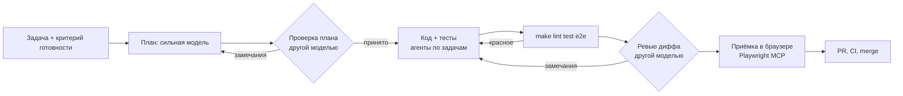

# AI-workflow: как я веду разработку с агентами

Кейсы SellerDesk, ShopProbe и OrderFlow написаны в связке «я + Claude Code + Codex». Здесь лежит то,
чем эта связка управляется: инструкции проекта, агенты, команды, skills, подключение
Playwright MCP и правила ревью. Файлы рабочие. Установка в свой проект: `agents/`,
`commands/` и `skills/` скопировать в `.claude/`, `CLAUDE.md` — в корень,
`settings.example.json` — в `.claude/settings.json`, хук — в `.claude/hooks/block-secrets.sh`
(путь в настройках уже такой). Так они и установлены в
[SellerDesk](https://github.com/Georgy213123/sellerdesk): `CLAUDE.md`, `.claude/`, `.mcp.json`.

## Роли

| Кто | Что делает | Почему он |
|---|---|---|
| Я | формулирую задачу и критерий готовности, утверждаю план, принимаю результат | ответственность за то, что уходит в `main`, остаётся на человеке |
| Claude Code, сильная модель | план, архитектура, разбор сложных багов, оркестрация агентов | длинный контекст, держит весь план |
| Claude Code, быстрая модель | рутина по готовому плану: тесты, шаблонный код, правки по списку | дешевле и быстрее, план уже проверен |
| Codex | проверка плана и ревью диффа, только чтение ([команда](commands/codex-review.md)) | другая модель ошибается в других местах |
| Playwright MCP | агент сам открывает стенд, кликает и смотрит консоль и сеть | проверяет то, чего не видят тесты: консоль, сеть, вёрстку |

## Конвейер задачи

> В трёх демо-проектах шаг «проверка плана другой моделью» не выполнялся: проекты небольшие,
> Codex смотрел готовый код. Схема — как я веду рабочие задачи; что было на самом деле,
> записано в `docs/04-ai-development.md` каждого проекта.

1. **Бриф** из четырёх частей: цель (что должно работать), контекст (какие файлы есть,
   что уже работает), критерий (как проверить, конкретно), образец (похожий код, на который
   равняться). Без критерия задача агенту не отдаётся.
2. **План** пишет сильная модель в файл. План ревьюит другая модель, не видя ответа первой.
   Её замечания я сверяю с кодом, потом правлю план.
3. **Декомпозиция.** План режется на задачи, каждая со своим входом и критерием.
   Независимые задачи идут параллельно, но одновременно работает не больше трёх агентов,
   и два агента никогда не пишут в одни и те же файлы.
4. **Код.** Баг чинится так: сначала тест, который падает, потом фикс.
5. **Ревью.** Дифф смотрит другая модель по [чек-листу](agents/reviewer.md); Codex запускается
   командой [`/codex-review`](commands/codex-review.md).
6. **Приёмка.** Агент проходит сценарий на стенде через Playwright MCP: ошибки консоли,
   ответы сети, два разрешения экрана. Отчёт агента для меня гипотеза. Спорные числа
   перепроверяю сам.

## Агент без человека: обвязка долгого прогона

Конвейер выше — работа агентов вместе со мной. Агент-маркетолог в
[SellerDesk](https://github.com/Georgy213123/sellerdesk#агент-маркетолог) работает сам,
раз в неделю по таймеру, и обвязан тем, что нужно долгому автономному прогону:
чекпоинт после каждого шага, резерв бюджета токенов до вызова модели, лимит шагов,
аренда с heartbeat, повтор временных ошибок и журнал событий. Наружу он не пишет:
результат — предложения на согласование. Решения описаны в
[ADR-0004](https://github.com/Georgy213123/sellerdesk/blob/main/docs/03-design/adr/0004-autonomous-agent.md).

## Правила, которые появились из ошибок

- [**Пустой ответ ревьюера — не одобрение**](rules/empty-review-is-not-approval.md).
- [**Отчёт агента — это гипотеза**](rules/agent-report-is-a-hypothesis.md):
  число попадает в отчёт только после моего замера.
- **Секреты агенту не показываем.** Главное — секретов нет в рабочей копии агента. Поверх этого
  deny-правила и хук на команды Bash ([settings.example.json](settings.example.json),
  [hooks/block-secrets.sh](hooks/block-secrets.sh)). Хук ловит случайное чтение и типовые обходы
  (`.e""nv`, маски, `cat .env.example .env`), но команду, собранную во время выполнения (base64,
  переменные), не узнает. Тесты хука с этими случаями — в [hooks/tests](hooks/tests/block-secrets.test.sh).
- **Короткий CLAUDE.md:** роутер на 30–60 строк, подробности в отдельных файлах по запросу.
  Чем короче постоянный контекст, тем меньше агент путается и тем дешевле сессия.

## Содержимое

| Путь | Что это |
|---|---|
| [CLAUDE.md](CLAUDE.md) | инструкции проекта для Claude Code (образец на SellerDesk) |
| [agents/](agents/) | субагенты: planner, implementer, reviewer, e2e-acceptor |
| [commands/](commands/) | слэш-команды: `/plan`, `/review`, `/codex-review`, `/accept`, `/bugfix` |
| [skills/](skills/) | skills: приёмка e2e, контракт API |
| [mcp/](mcp/) | подключение Playwright MCP и как агент им пользуется |
| [hooks/](hooks/), [settings.example.json](settings.example.json) | ограничения доступа агента |
| [rules/](rules/) | правила ревью и приёмки |
| [examples/task-walkthrough.md](examples/task-walkthrough.md) | одна задача от брифа до merge, со всеми замечаниями |
